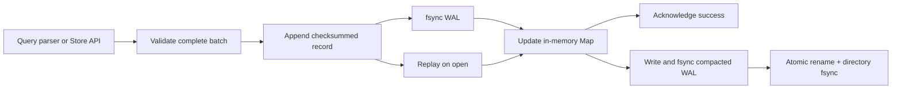

# Keystone KV

[GitHub repository](https://github.com/addo12kwame/keystone-kv) · [Automated checks](https://github.com/addo12kwame/keystone-kv/actions)

A small persistent key-value database implemented from first principles in TypeScript, using only Node's standard library at runtime. Built to explore write-ahead logging, recovery, atomic batches, indexing, and compaction.

## Run

Requires Node.js 24 or newer.

```sh
git clone https://github.com/addo12kwame/keystone-kv.git
cd keystone-kv
npm ci
npm start
```

The default directory is `data/`. To select another directory:

```sh
npm start -- ./data/example
```

```text
SET "user:1" {"name":"Alex","role":"analyst"}
GET "user:1"
HAS "user:1"
SCAN "user:" LIMIT 10
DELETE "user:1"
STATS
COMPACT
EXIT
```

Keys are JSON-quoted strings, so spaces and escaped characters are supported. Values are JSON, including null, booleans, arrays, and objects. GET returns `{found:false}` for a missing key and `{found:true,value:null}` for an explicitly stored null. SCAN returns lexicographically sorted keys matching a prefix; it is not SQL or a document-field query engine.

For scripts, pipe one command per line to `npm start --silent`. Errors go to stderr and cause a nonzero final exit status; subsequent commands are still processed. Interactive mode displays prompts and readable JSON.

## API

```ts
import { Store } from "./src/store.ts";
const db = new Store("./data");
try {
  db.batch([
    { type: "set", key: "account:1", value: { name: "Alex" } },
    { type: "set", key: "account:2", value: { name: "Maya" } },
  ]);
  console.log(db.get("account:1"));
  console.log(db.scan("account:", 10));
  console.log(db.compact());
} finally {
  db.close();
}
```

## Storage design



Each newline-terminated WAL frame contains a JSON payload and its SHA-256 digest. The payload includes a format version, monotonically increasing sequence number, and operations. A batch is one frame, so a partial final frame cannot expose half a batch on recovery.

SET and DELETE append and `fsync` before updating the in-memory index. Deletes are tombstones. Reads and scans return copies, preventing caller mutation from silently bypassing persistence. The write loop handles partial OS writes.

On open, complete records are validated and replayed. A final unterminated frame is treated as a torn write and truncated before further appends. A complete invalid record, including a checksum mismatch, fails recovery rather than silently dropping data. A write error poisons the instance: close and reopen before continuing, since its durable outcome may be uncertain.

Compaction writes one SET frame for each live key to a same-directory temporary file, flushes it, atomically renames it over the WAL, syncs the directory, and reopens the append descriptor. The prior WAL remains authoritative until rename. Empty compaction emits a harmless delete frame to retain the sequence watermark. Temporary files left by a crash are ignored. Compaction is synchronous and blocks reads/writes in the current process.

## Locking and recovery

An exclusive `LOCK` file prevents two cooperative processes from opening the same directory. It records the owner's PID. Graceful close removes it. After a process crash, **verify that no database owner is running before manually removing the stale LOCK file**. Automatic PID-based lock stealing is intentionally avoided because PID reuse can make it unsafe.

Do not edit or replace the directory while a database is open. Use a local filesystem with atomic same-directory rename and file/directory fsync support. The implementation is aimed at POSIX local filesystems; Windows and network filesystems are not validated. Durability assumes the OS and storage device honor flushes. The killed-process test is not a simulated machine power-loss test.

## Tests

```sh
npm run build
npm test
```

Tests cover persistence, tombstones, null values, sorted scans, all-or-nothing batch validation, replay, torn-tail truncation, checksum corruption, compaction, sequence preservation, exclusive locking, immutable read snapshots, query errors, and recovery of an acknowledged write after SIGKILL. The crash test verifies the child is dead before removing its stale lock.

## Limits and tradeoffs

- Single process/writer, synchronous filesystem I/O, and a complete in-memory key/value index.
- GET is expected O(1); SCAN filters and sorts the index, O(n log n) worst case.
- Recovery is O(WAL bytes); compaction is O(live data) and needs temporary disk space.
- One fsync per batch; no group commit or asynchronous write queue.
- Keys: 1–1,024 UTF-8 bytes. Batch: 1–1,000 operations. Encoded frame: at most 4 MB.
- No transactions across batches, isolation levels, range indexes, TTL, replication, or network server.
- Checksums detect accidental corruption; they do not authenticate data against malicious edits.
- This is an educational database, not a substitute for a production storage engine.

Good follow-up milestones: fault-injection tests at every write/rename boundary, segmented logs and immutable tables, sparse indexes, background compaction, and a benchmark suite with reproducible workload parameters.

## Publication status

The source code is public on GitHub. Keystone runs locally as a CLI or library; it is not a hosted database service.
